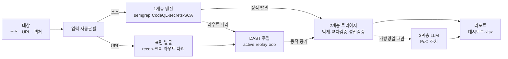

# OKRA — SAST + DAST 통합 진단기

소스 코드를 주면 정적 분석(SAST), 살아있는 URL을 주면 동적 점검(DAST). 둘 다 주면 **정적에서 찾은 의심 지점을 실제로 쏴서 확증**까지 한다. 인터넷이 없는 폐쇄망에서도 도구 혼자 돌아가는 걸 목표로 만들었다.

여러 현장에 반입해 쓰는 범용 도구다. `git clone` 후 `tar`로 옮겨 폐쇄망에서 실행한다.

## 어떻게 도는가



대상을 넣으면 종류를 자동 판별한다. 1계층이 룰로 훑고 표면을 발굴하면, DAST가 실제로 찔러보고, 2계층이 정탐/오탐을 가른다. 인터넷과 LLM이 있으면 3계층이 PoC까지 붙인다. 결과는 대시보드와 엑셀로 나온다.

## 1·2·3 계층이 하는 일

**1계층 — 찾기 (오프라인, 외부통신 0)**
룰 기반 스캐너 4종이 소스를 훑는다.
- `semgrep` — 패턴 매칭 (+ 현장 스택 보강용 OKRA 커스텀 룰)
- `CodeQL` — 데이터 흐름(taint) 분석, 패턴이 못 보는 흐름 취약점 (`--deep`)
- `secrets` — 평문 비밀번호·API키·주민번호(체크섬)·카드번호(Luhn) 등 (탐지값은 마스킹)
- `SCA` — 의존성 lockfile의 알려진 CVE (osv-scanner)

여기까지 외부 통신이 0이다. 폐쇄망에선 이 계층만으로 점검이 끝난다.

**2계층 — 거르기 (오프라인 판정, LLM은 선택)**
1계층이 뱉은 "의심"을 실제 취약 여부로 판정한다.
- 억제 — 명백한 오탐 제거 (룰은 `rules/suppress.json`, 코드 안 건드리고 늘림)
- 교차검증 — 패턴 엔진 오탐을 CodeQL taint로 정정
- 성립검증 — 취약점마다 전제조건(입력 제어·싱크 도달·방어 부재)을 증거와 대조해 **확정 / 오탐 / 검토필요**로 분류

이 판정도 인터넷 없이 된다. LLM이 설정돼 있으면 판정을 한 번 더 보조한다.

**3계층 — 심화 (개방망 또는 로컬 LLM일 때만)**
확정된 취약점에 복붙 가능한 PoC와 조치 방법을 붙인다. LLM이 없으면 아예 실행되지 않으니 폐쇄망에서 안전하다.

**사이를 잇는 두 축:**
- **표면 발굴** — 하위도메인 열거, URL 크롤, 그리고 **라우트 다리**. 소스의 라우트 정의(`@GetMapping`·Flask·Express 등)를 뽑아 DAST에 넘긴다. SPA나 인증 뒤에 숨어 크롤로는 못 찾는 엔드포인트를 이렇게 연다.
- **DAST** — 살아있는 대상에 실제 payload를 주입해 SQLi·XSS·IDOR 등을 라이브로 확증한다. 1계층의 "의심"을 실증으로 올린다.

## 명령어 — 셋 중 하나

능동 DAST(패킷 전송)는 **인가받은 대상에만** 쓴다.

| 명령 | 하는 일 | 하위도메인 정찰 | LLM |
|---|---|:---:|:---:|
| `./okra <URL> --active` | 능동 DAST(GET만, 안전) + 오프라인 트리아지 | ✅ | ✗ |
| `./okra <URL> --full` | `--active` + **상태변경(POST/PUT) 점검** + LLM 심화 | ✅ | ✅ (설정 시) |
| `./okra <URL> --domain` | `--active`를 이 도메인 하나만 | ✗ | ✗ |

깊이는 이 세 모드로만 정한다. `--active`는 GET만 찔러 안전하고, `--full`은 상태변경 엔드포인트까지 점검한다(삭제·결제·초기화 같은 파괴적 동사는 어느 모드에서도 제외). 즉 **점검 강도를 모드 하나로** 고른다.

플래그를 안 주면 **안전 패시브** — 능동 프로브 0, 비파괴다.

```bash
./okra ./myapp                              # 소스 정적 분석 (폐쇄망, 패킷 0)
./okra ./myapp --deep                       # + CodeQL taint 엔진
./okra https://app.example.com --active     # URL 능동 점검 + 하위도메인 정찰
./okra ./myapp https://app.example.com --full   # 소스+URL 통합, LLM 심화까지
./okra ./capture.har --active               # 캡처 replay (실요청 기반, 더 정밀)
```

자주 쓰는 옵션:
- `--no-recon` — 하위도메인 정찰 끄기 / `--recon-passive` — crt.sh·Wayback·DoH 패시브 소스까지 (도메인이 제3자로 나감)
- `--cookie 'SESSION=..'` , `-H 'Authorization: Bearer ..'` — 인증 세션·헤더 주입
- `--oob` — blind SSRF/XXE/RCE를 콜백 역접속으로 확증
- `--insecure` — 자기서명 인증서 대상(TLS 검증 끔)

로그인 자동화(인가 대상 전용, 자격증명은 환경변수로만·로그엔 마스킹):
```bash
export SAST_LOGIN_USER=alice SAST_LOGIN_PASS=****        # 계정 A
export SAST_LOGIN_USER2=bob  SAST_LOGIN_PASS2=****       # 계정 B(주면 IDOR 확정)
./okra https://app.example.com --active
```
캡처에 로그인 트래픽이 있으면 자격증명을 자동 추출하고, 세션이 만료되면 자동 재로그인한다.

## 입력 3종 — 자동 판별

| 넣는 것 | 인식 | 하는 일 |
|---|---|---|
| 폴더 | 소스 | SAST (1·2·3계층) |
| `http(s)://…` | 라이브 URL | DAST (블랙박스·능동) |
| 파일 (Burp XML / HAR) | 캡처 | 패시브 분석 + replay (패킷 0으로 시작) |

셋을 같이 주면 통합 스캔에 SAST↔캡처 상관분석까지 한 번에 돈다. `./okra`는 `./sast-run.sh`의 별칭이고, 대상은 로컬 경로·git URL·`owner/repo`·`targets/` 폴더명도 된다.

## 결과물

`out/<이름>/`에 세 가지가 나온다.
- `index.html` — 자체완결 대시보드 (더블클릭)
- `<도메인>_result.xlsx` — Endpoints(경로·상태코드·민감도·파라미터·인증) · Recon(하위도메인·IP) · Exposure(본문서 흘러나온 시크릿·오류, 마스킹) 3시트
- `results.json` — 원본 데이터 (`dashboard.template.html`에 드래그드롭하면 다른 결과도 같은 뷰어로 봄)

## 폐쇄망 반입 (carry-in kit)

무거운 의존성을 전부 repo 안 `tools/` 한 곳에 모아 통째로 옮기는 모델이다.
```bash
# 온라인 머신에서 (1회)
git clone <repo> && cd sast-draft
./provision.sh          # tools/ 에 수집: semgrep 룰 + osv(바이너리+오프라인 CVE DB) + CodeQL 번들
./package.sh            # → ../sast-kit.tar.zst

# 폐쇄망에서
tar --use-compress-program=unzstd -xf sast-kit.tar.zst && cd sast-draft
export SAST_TOOLS_DIR=$(pwd)/tools SAST_OSV_OFFLINE=1
./okra <대상> [URL] --deep
```
엔진은 `SAST_TOOLS_DIR`(기본 `<repo>/tools`)에서 자동 탐색한다. 특정 머신 경로에 묶이지 않는다.

LLM 계층(선택)은 `SAST_LLM_KEY` + `SAST_LLM_ENDPOINT`(기본 Anthropic) + `SAST_LLM_MODEL`로 붙인다. 사내 게이트웨이나 로컬 Ollama로 교체 가능하고, stdlib만 쓴다.

## 구조

```
sast/
  engines/            엔진 레지스트리 + run_all (fingerprint 로 dedup)
    semgrep_engine.py   패턴 (기본, 로컬 룰 번들 → 오프라인)
    codeql_engine.py    taint/dataflow (--deep, JS/TS·Python·Java)
    secrets_engine.py   평문 시크릿·개인정보 (stdlib 정규식)
    sca_engine.py       의존성 CVE (osv-scanner)
  semgrep-rules-custom/ OKRA 커스텀 룰 (현장 스택 보강, 파일만 늘려 확장)
  rules/              suppress.json·secrets_patterns.json·attack_playbook.json (데이터 — 코드 수정 없이 확장)
  core/               config·context·pipeline (실행 뼈대)
  recon.py            표면 발굴: 하위도메인·crt.sh·Wayback·DoH
  routes.py           라우트 다리: 소스 라우트 → DAST 프로브 표면
  active.py           경량 능동 DAST: 크롤 + payload 주입 + 본문 누수 스캔
  replay.py           캡처/URL replay: 무인증·SQLi·XSS·IDOR 등 role 엔진
  okra.py             OKRA DAST: OWASP ZAP 구동 + 응답 본문 중요정보 스캔 (SAST_OKRA=1)
  oob.py              blind SSRF/XXE/RCE 콜백 리스너 (--oob)
  capture.py          캡처(Burp/HAR) 오프라인 파싱 → 엔드포인트 인벤토리
  correlate.py        SAST↔캡처 상관 (도달확인·증상확증, 패킷0)
  login.py            로그인 자동화·2계정 IDOR·브루트포스 (인가 전용)
  triage.py           억제·심각도 / crossval.py 교차검증 / layer2.py 성립검증
  layer2.py·layer3.py LLM 트리아지·심화 (개방망 전용)
  report.py·xlsx.py   대시보드 + 결과 워크북 (stdlib)
sast-run.sh / .bat    러너 (clone→scan). ./okra 별칭.
out/ , targets/       생성물 / 클론 대상 (git 제외)
```

## 설계 원칙

- **재현율 보호** — 오탐은 하드 억제보다 강등이 기본. 점검에서 미탐이 오탐보다 비싸다.
- **폐쇄망 자립** — 코어는 stdlib만, 1·2계층이 외부통신 0으로 완결. LLM은 검증자로만.
- **데이터 주도 확장** — 룰(suppress·secrets·playbook·custom semgrep)을 파일로 늘린다. 코드는 잘 안 건드린다.
- **안전 기본값** — 능동 DAST는 인가 대상 전용, 상태변경은 옵트인, 파괴적 동사는 제외.

## 스키마 (sast-results/2)

`results.json` = `{ meta, summary, findings[] }`. finding 주요 필드:
`id, fingerprint, engines[], rule, category, severity, verdict, confidence, file, line, cwe[], owasp[], code, message, rationale, evidence, poc, reachable, source, dynamic, suppressed`.
